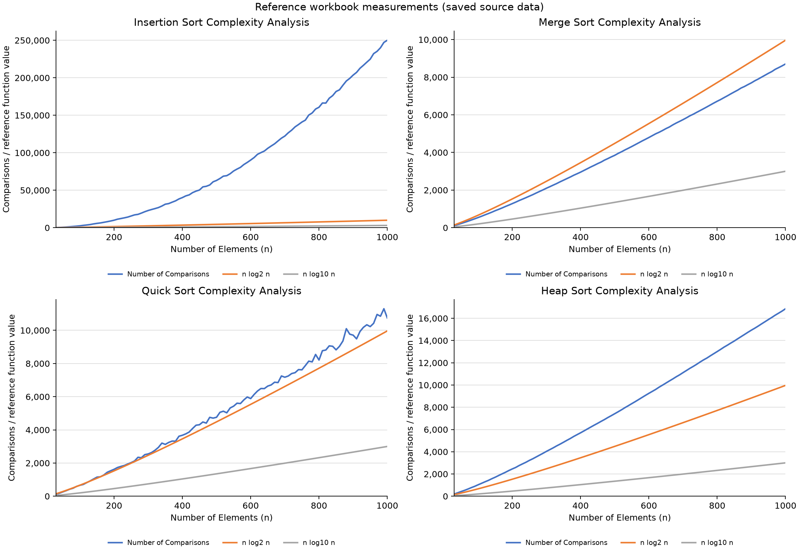

# Sorting Algorithms in C++ — Reference-Aligned DAA Labs

This repository follows the sorting code and saved Excel measurements in
[Aayush-data-eng/Design-And-Analysis-of-Algorithm](https://github.com/Aayush-data-eng/Design-And-Analysis-of-Algorithm/tree/fb018e38df9ed2223aa6991af28c2b7294e8912f),
commit `fb018e38df9ed2223aa6991af28c2b7294e8912f`.
Credit for the reference programs and workbook data belongs to that repository's author.
The sorting subset is adapted here with documented compilation, memory-safety and chart corrections.
The upstream README describes a B.Sc. Physical Science course; this copy preserves its sorting lab setup.

## Programs

| Reference file | Experiment | Preserved settings |
|---|---|---|
| [lab/lab1.cpp](lab/lab1.cpp) | Insertion sort | Sizes 30–1000, step 10, ten instances; reference insertion counter |
| [lab/lab2.cpp](lab/lab2.cpp) | Merge sort | Same size/instance schedule; comparisons during merging |
| [lab/lab3.cpp](lab/lab3.cpp) | Quick sort | Last-element pivot, strict `< pivot` comparison |
| [lab/lab4.cpp](lab/lab4.cpp) | Heap sort | Existing-child value comparisons |
| [lab/lab5.cpp](lab/lab5.cpp) | Counting sort | Exact original 20 integers; one `clock()` timing |
| [lab/lab6.cpp](lab/lab6.cpp) | Radix sort | Exact original 20 integers; one `clock()` timing |
| [lab/lab7.cpp](lab/lab7.cpp) | Bucket sort | Exact original 20 fractions; one `clock()` timing |

The reference's three simpler examples are in [Sorting/](Sorting/), including its original
`bubbleSorst.cpp` filename. Existing `src/*.cpp` filenames are aliases to their corresponding
`lab/labN.cpp` files, so both paths use the same implementation.
Each source has its own `main()` and compiles independently. No shared project headers are needed.

## Build and run

Requires a C++17 compiler. Compile one program, or build all ten:

```sh
c++ -std=c++17 -O2 -Wall -Wextra -Wpedantic lab/lab1.cpp -o lab1
./lab1

make all
make run
make test
make sanitize
```

On Windows, compile the canonical `lab/` or `Sorting/` source directly and use an `.exe`
output name; symlink support is not needed for those paths. Python 3.10+ is needed for tests.
GCC and Clang are supported. GitHub Actions runs regular and sanitizer checks.

Like the reference, labs 1 and 2 print labelled size/average lines; labs 3 and 4 print
one average per line. Labs 5–7 print the original array, sorted array and elapsed milliseconds.
Successful programs exit with status zero. They use built-in inputs and require no keyboard input.

## Matching the graphs

The four original native Excel workbooks are in `lab/`, with the same sheet, measured values,
formulas, chart styles and positions. The insertion workbook's chart categories are corrected
from `A1:A99` to `A2:A99`, with matching 98-entry category caches. No measured values change.
The other three workbooks are byte-for-byte copies of upstream.



PNG/SVG exports plot the exact saved workbook values with the same three series:
`Number of Comparisons`, `n log2 n`, and `n log10 n`. Their rendering uses Matplotlib;
use the Excel workbooks for the original native Excel presentation. Exports are not
pixel-identical screenshots of Excel.

```sh
python3 -m venv .venv
.venv/bin/python -m pip install -r requirements.txt
.venv/bin/python scripts/plot_comparisons.py
.venv/bin/python scripts/summarize_results.py
```

On Windows, use `.venv\Scripts\python.exe`. Generated graphs are already included.
[REPORT.md](REPORT.md) contains the source measurements; the CSVs in `results/` are
exports of those same workbook values. Raw upstream trial data is unavailable and is not invented.

Fresh runs follow the reference's `srand(time(0))` and
`(rand() + index + instance) % 1000` generation pattern, evaluated with a wider intermediate
to prevent signed overflow. New random measurements will vary with seed, platform and run.
They do not overwrite the saved source workbooks or their graphs. To save a new run separately:

```sh
mkdir -p results/fresh
./build/lab1 > results/fresh/lab1.txt
```

Matching saved measurements does not mean a fresh random execution will reproduce them.
The original random seeds and raw arrays are not recorded in the reference repository.

## Corrections and verification

See [REFERENCE_ALIGNMENT.md](REFERENCE_ALIGNMENT.md) for every intentional code/workbook deviation,
and [LAB_NOTES.md](LAB_NOTES.md) for algorithm and counter explanations.
The reference's insertion counter is retained even though it is not an exact count of all
executed key comparisons: it equals successful shifts plus `n - 1` for a nonempty array.
Counting sort supports integer values in `[0, 1000000]`, radix sort nonnegative integers,
and bucket sort finite floats in `[0, 1)`; invalid inputs throw `std::invalid_argument`.
The original valid demo inputs are unchanged.

Regression checks cover exhaustive permutations through seven elements, random and duplicate-heavy
arrays, integer boundaries, empty arrays, variable-sized buffers, exact counters captured from the
unmodified upstream functions, standalone demo outputs and workbook chart bindings. Workbook tests
also verify that unrelated package parts remain unchanged.

The previous implementations, 25-element/15000-element experiments, graphs and PDF guide remain
available in Git under tag [`before-reference-alignment-f3d768f`](https://github.com/im-lakshyaveerturna/sorting-algorithms-cpp/tree/before-reference-alignment-f3d768f).
They were superseded here because they describe a different experiment setup.
