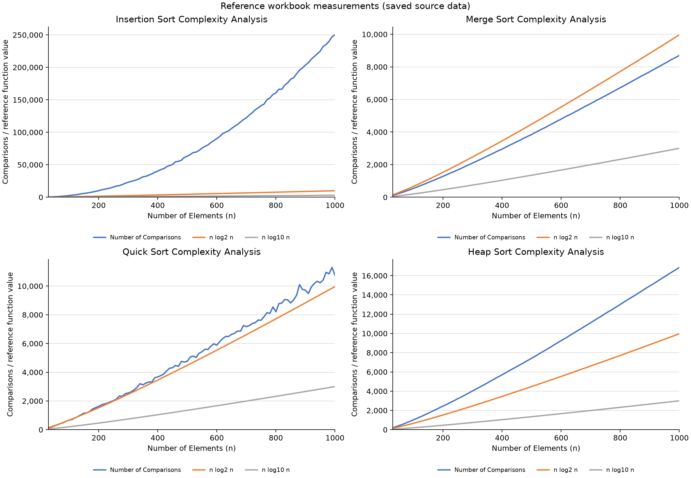

# Reference sorting lab results

These are the saved measurements from the upstream Excel workbooks at commit
`fb018e38df9ed2223aa6991af28c2b7294e8912f`, preserved without changing values.
They are historical source data, not measurements of a new execution here.

The first four labs use sizes 30 through 1000, step 10, ten random instances per size.
Insertion uses the reference counter: successful shifts plus one per insertion.
Quick sort uses `< pivot`. The source uses `srand(time(0))`; fresh runs vary.
Raw trials and the original random seed are not present upstream, so they cannot be reconstructed.

| n | Insertion | Merge | Quick | Heap | n log2 n | n log10 n |
|---:|---:|---:|---:|---:|---:|---:|
| 30 | 231.10 | 111.90 | 120.50 | 202.80 | 147.21 | 44.31 |
| 40 | 405.60 | 165.90 | 180.70 | 305.00 | 212.88 | 64.08 |
| 50 | 655.40 | 223.50 | 260.00 | 418.10 | 282.19 | 84.95 |
| 60 | 921.30 | 282.90 | 336.40 | 523.80 | 354.41 | 106.69 |
| 70 | 1,286.20 | 343.70 | 421.10 | 642.70 | 429.05 | 129.16 |
| 80 | 1,675.10 | 408.90 | 482.40 | 771.50 | 505.75 | 152.25 |
| 90 | 2,067.80 | 473.70 | 590.50 | 889.50 | 584.27 | 175.88 |
| 100 | 2,507.20 | 541.30 | 659.40 | 1,027.70 | 664.39 | 200.00 |
| 110 | 3,133.30 | 609.30 | 709.60 | 1,159.10 | 745.95 | 224.55 |
| 120 | 3,640.10 | 682.80 | 819.40 | 1,294.20 | 828.83 | 249.50 |
| 130 | 4,219.90 | 752.20 | 923.40 | 1,421.70 | 912.91 | 274.81 |
| 140 | 5,077.40 | 825.00 | 1,039.10 | 1,571.30 | 998.10 | 300.46 |
| 150 | 5,781.60 | 903.80 | 1,150.10 | 1,708.10 | 1,084.32 | 326.41 |
| 160 | 6,365.40 | 974.70 | 1,172.70 | 1,860.00 | 1,171.51 | 352.66 |
| 170 | 7,205.70 | 1,048.40 | 1,279.80 | 2,008.20 | 1,259.60 | 379.18 |
| 180 | 8,043.10 | 1,127.90 | 1,442.50 | 2,151.40 | 1,348.53 | 405.95 |
| 190 | 8,967.20 | 1,202.00 | 1,534.60 | 2,309.70 | 1,438.27 | 432.96 |
| 200 | 9,995.40 | 1,281.00 | 1,621.80 | 2,453.20 | 1,528.77 | 460.21 |
| 210 | 11,357.90 | 1,358.60 | 1,729.80 | 2,585.60 | 1,619.99 | 487.67 |
| 220 | 12,249.00 | 1,443.30 | 1,795.70 | 2,758.00 | 1,711.90 | 515.33 |
| 230 | 13,164.10 | 1,519.10 | 1,852.40 | 2,907.40 | 1,804.46 | 543.20 |
| 240 | 14,186.80 | 1,596.40 | 1,941.20 | 3,052.90 | 1,897.65 | 571.25 |
| 250 | 15,653.10 | 1,676.90 | 2,026.10 | 3,220.30 | 1,991.45 | 599.49 |
| 260 | 17,120.30 | 1,756.30 | 2,125.10 | 3,366.60 | 2,085.82 | 627.89 |
| 270 | 17,802.00 | 1,844.00 | 2,345.80 | 3,530.80 | 2,180.74 | 656.47 |
| 280 | 19,493.90 | 1,929.20 | 2,321.00 | 3,696.10 | 2,276.20 | 685.20 |
| 290 | 21,359.70 | 2,011.60 | 2,506.00 | 3,860.80 | 2,372.17 | 714.10 |
| 300 | 22,978.80 | 2,099.80 | 2,549.20 | 4,032.00 | 2,468.65 | 743.14 |
| 310 | 24,301.60 | 2,180.60 | 2,636.00 | 4,191.40 | 2,565.60 | 772.32 |
| 320 | 25,536.00 | 2,265.70 | 2,772.30 | 4,352.90 | 2,663.02 | 801.65 |
| 330 | 26,894.60 | 2,348.00 | 2,946.30 | 4,526.90 | 2,760.89 | 831.11 |
| 340 | 28,923.20 | 2,440.20 | 3,201.30 | 4,684.60 | 2,859.19 | 860.70 |
| 350 | 31,369.70 | 2,525.40 | 3,124.50 | 4,854.60 | 2,957.92 | 890.42 |
| 360 | 32,189.10 | 2,611.20 | 3,243.10 | 5,027.80 | 3,057.07 | 920.27 |
| 370 | 34,055.60 | 2,696.50 | 3,322.60 | 5,192.40 | 3,156.61 | 950.23 |
| 380 | 35,826.60 | 2,789.50 | 3,316.50 | 5,376.50 | 3,256.55 | 980.32 |
| 390 | 38,385.00 | 2,870.30 | 3,615.20 | 5,540.70 | 3,356.86 | 1,010.52 |
| 400 | 40,189.60 | 2,953.90 | 3,674.60 | 5,702.90 | 3,457.54 | 1,040.82 |
| 410 | 42,434.70 | 3,045.80 | 3,758.40 | 5,874.50 | 3,558.59 | 1,071.24 |
| 420 | 43,833.90 | 3,137.30 | 3,870.80 | 6,048.50 | 3,659.98 | 1,101.76 |
| 430 | 46,838.10 | 3,230.50 | 4,084.60 | 6,221.90 | 3,761.72 | 1,132.39 |
| 440 | 48,810.60 | 3,316.20 | 4,279.40 | 6,392.50 | 3,863.80 | 1,163.12 |
| 450 | 50,292.10 | 3,407.10 | 4,310.00 | 6,557.60 | 3,966.20 | 1,193.95 |
| 460 | 54,472.60 | 3,489.80 | 4,474.20 | 6,730.90 | 4,068.93 | 1,224.87 |
| 470 | 55,245.40 | 3,592.80 | 4,407.60 | 6,897.10 | 4,171.96 | 1,255.89 |
| 480 | 57,001.80 | 3,676.40 | 4,754.50 | 7,078.80 | 4,275.31 | 1,287.00 |
| 490 | 61,232.80 | 3,766.10 | 4,707.00 | 7,246.60 | 4,378.95 | 1,318.20 |
| 500 | 63,059.90 | 3,848.30 | 4,759.00 | 7,420.70 | 4,482.89 | 1,349.49 |
| 510 | 65,649.80 | 3,950.80 | 5,056.70 | 7,595.70 | 4,587.12 | 1,380.86 |
| 520 | 68,766.80 | 4,037.90 | 5,123.90 | 7,775.50 | 4,691.63 | 1,412.32 |
| 530 | 69,426.00 | 4,135.90 | 5,028.80 | 7,967.40 | 4,796.42 | 1,443.87 |
| 540 | 72,044.10 | 4,225.20 | 5,321.50 | 8,143.40 | 4,901.48 | 1,475.49 |
| 550 | 75,661.40 | 4,317.80 | 5,427.70 | 8,328.10 | 5,006.81 | 1,507.20 |
| 560 | 78,216.70 | 4,414.40 | 5,606.20 | 8,506.20 | 5,112.40 | 1,538.99 |
| 570 | 80,528.00 | 4,511.20 | 5,587.30 | 8,693.70 | 5,218.25 | 1,570.85 |
| 580 | 84,262.90 | 4,609.50 | 5,806.30 | 8,884.10 | 5,324.35 | 1,602.79 |
| 590 | 87,121.80 | 4,701.30 | 5,981.00 | 9,071.30 | 5,430.70 | 1,634.80 |
| 600 | 90,258.70 | 4,795.50 | 5,885.70 | 9,253.70 | 5,537.29 | 1,666.89 |
| 610 | 93,589.20 | 4,894.20 | 6,132.00 | 9,429.50 | 5,644.13 | 1,699.05 |
| 620 | 97,925.80 | 4,993.20 | 6,342.10 | 9,606.40 | 5,751.20 | 1,731.28 |
| 630 | 100,178.00 | 5,074.70 | 6,492.90 | 9,810.10 | 5,858.50 | 1,763.58 |
| 640 | 102,283.00 | 5,168.30 | 6,488.00 | 9,991.80 | 5,966.03 | 1,795.96 |
| 650 | 105,931.00 | 5,269.00 | 6,638.70 | 10,178.50 | 6,073.79 | 1,828.39 |
| 660 | 109,003.00 | 5,354.90 | 6,708.90 | 10,366.40 | 6,181.77 | 1,860.90 |
| 670 | 111,929.00 | 5,466.10 | 6,872.10 | 10,547.70 | 6,289.97 | 1,893.47 |
| 680 | 115,728.00 | 5,564.50 | 6,850.80 | 10,741.70 | 6,398.39 | 1,926.11 |
| 690 | 119,449.00 | 5,653.80 | 7,248.40 | 10,917.00 | 6,507.01 | 1,958.81 |
| 700 | 122,281.00 | 5,745.50 | 7,173.60 | 11,115.40 | 6,615.85 | 1,991.57 |
| 710 | 126,594.00 | 5,843.00 | 7,246.50 | 11,307.00 | 6,724.89 | 2,024.39 |
| 720 | 130,148.00 | 5,948.40 | 7,394.50 | 11,501.20 | 6,834.13 | 2,057.28 |
| 730 | 134,527.00 | 6,034.40 | 7,447.70 | 11,678.40 | 6,943.58 | 2,090.23 |
| 740 | 137,638.00 | 6,133.00 | 7,632.10 | 11,867.40 | 7,053.22 | 2,123.23 |
| 750 | 140,961.00 | 6,228.30 | 7,619.90 | 12,071.50 | 7,163.06 | 2,156.30 |
| 760 | 143,486.00 | 6,325.40 | 7,873.90 | 12,260.30 | 7,273.09 | 2,189.42 |
| 770 | 150,254.00 | 6,424.10 | 8,141.70 | 12,429.30 | 7,383.31 | 2,222.60 |
| 780 | 153,074.00 | 6,525.20 | 8,098.30 | 12,629.20 | 7,493.72 | 2,255.83 |
| 790 | 158,307.00 | 6,626.70 | 8,545.80 | 12,820.30 | 7,604.31 | 2,289.13 |
| 800 | 160,722.00 | 6,723.20 | 8,210.00 | 13,010.50 | 7,715.08 | 2,322.47 |
| 810 | 166,340.00 | 6,813.70 | 8,770.80 | 13,205.10 | 7,826.04 | 2,355.87 |
| 820 | 166,256.00 | 6,915.00 | 8,813.50 | 13,408.80 | 7,937.17 | 2,389.33 |
| 830 | 172,756.00 | 7,013.20 | 9,063.60 | 13,586.90 | 8,048.48 | 2,422.83 |
| 840 | 176,200.00 | 7,117.30 | 9,037.30 | 13,777.40 | 8,159.97 | 2,456.39 |
| 850 | 181,713.00 | 7,216.80 | 8,824.00 | 13,958.20 | 8,271.62 | 2,490.01 |
| 860 | 183,966.00 | 7,313.60 | 9,037.70 | 14,158.20 | 8,383.45 | 2,523.67 |
| 870 | 190,033.00 | 7,426.60 | 9,356.20 | 14,353.20 | 8,495.44 | 2,557.38 |
| 880 | 195,711.00 | 7,508.70 | 10,098.50 | 14,547.50 | 8,607.60 | 2,591.14 |
| 890 | 199,221.00 | 7,607.50 | 9,768.70 | 14,744.80 | 8,719.92 | 2,624.96 |
| 900 | 203,586.00 | 7,700.50 | 9,709.50 | 14,934.40 | 8,832.40 | 2,658.82 |
| 910 | 207,221.00 | 7,809.70 | 9,486.20 | 15,111.50 | 8,945.05 | 2,692.73 |
| 920 | 212,683.00 | 7,902.50 | 9,929.60 | 15,301.00 | 9,057.85 | 2,726.68 |
| 930 | 216,629.00 | 8,004.90 | 10,180.60 | 15,501.80 | 9,170.81 | 2,760.69 |
| 940 | 220,806.00 | 8,105.90 | 10,334.90 | 15,695.10 | 9,283.93 | 2,794.74 |
| 950 | 224,867.00 | 8,208.40 | 10,224.80 | 15,891.90 | 9,397.19 | 2,828.84 |
| 960 | 232,232.00 | 8,301.40 | 10,424.30 | 16,082.20 | 9,510.61 | 2,862.98 |
| 970 | 235,291.00 | 8,421.80 | 10,957.30 | 16,285.00 | 9,624.19 | 2,897.17 |
| 980 | 240,068.00 | 8,511.10 | 10,851.20 | 16,467.80 | 9,737.91 | 2,931.40 |
| 990 | 247,188.00 | 8,604.00 | 11,301.10 | 16,652.50 | 9,851.77 | 2,965.68 |
| 1000 | 250,038.00 | 8,704.80 | 10,745.40 | 16,859.70 | 9,965.78 | 3,000.00 |

The native Excel charts are in `lab/`. Their existing layouts and styles are retained.
The insertion chart category range was corrected to exclude the header; its 98 measurements are unchanged.
PNG/SVG exports plot the same values and reference formulas, with Excel-style series colours.
They are not pixel-identical screenshots of Excel.

Labs 5–7 retain the exact 20-element demo inputs, single `clock()` measurements,
and original output format. Tiny durations can be zero and depend on the computer.
The previous 25-element and 15000-element measurements are kept in Git history
under tag `before-reference-alignment-f3d768f`.
